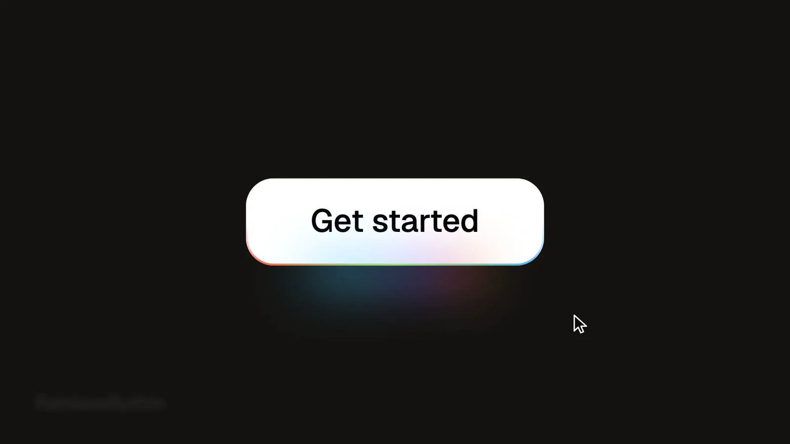

<p align="center">
  
</p>

# fancy-ui

Animated UI components for **Svelte 5**, **React** and **Vue 3**, styled with Tailwind CSS v4.

[](https://www.npmjs.com/package/fancy-ui-svelte)
[](https://www.npmjs.com/package/fancy-ui-react)
[](https://www.npmjs.com/package/fancy-ui-vue)


<p align="center">
  <a href="https://www.anthropic.com/claude-code">
    <picture>
      <source media="(prefers-color-scheme: dark)" srcset=".github/claude-for-open-source-program-dark.svg">
      
    </picture>
  </a>
</p>

<p align="center">
  <a href="https://fancy-ui.rama.app">
    
  </a>
</p>

<p align="center">
  <a href="https://fancy-ui.rama.app"><strong>Live Demo &amp; Docs</strong></a>
  &nbsp;·&nbsp;
  <a href="https://fancy-ui.rama.app/docs/components">Browse components</a>
  &nbsp;·&nbsp;
  <a href="./react/README.md">React package</a>
  &nbsp;·&nbsp;
  <a href="./vue/README.md">Vue package</a>
</p>

## Features

- **146 components** &mdash; core primitives (forms, navigation, overlays) alongside buttons, text animations, backgrounds, cursors, AI/chat building blocks and a micro-interactions collection
- **Motion that feels physical** &mdash; beams of light, liquid-metal and neon borders, a physical flip card, a before/after slider with a motion trail, a datamosh page transition; springs and WebGL where they earn their keep
- **Svelte 5 runes** &mdash; built with `$state`, `$derived`, `$effect` and `$props`; snippets, no legacy syntax
- **React and Vue editions** &mdash; [`fancy-ui-react`](./react/README.md) (React 18 and 19) and [`fancy-ui-vue`](./vue/README.md) (Vue 3.5+) ship the same components under the same names, ported from the Svelte source and kept at parity by CI
- **Tailwind CSS v4** &mdash; one CSS import, theme tokens, light and dark themes
- **Accessible and SSR-safe** &mdash; keyboard support where it applies, `prefers-reduced-motion` respected, canvas and WebGL work deferred to mount
- **Opt-in sound** &mdash; eleven synthesised interface cues, a `SoundToggle` switch and a `soundFeedback` action; silent until the user turns it on
- **AI-ready docs** &mdash; `llms.txt`, a Markdown page per component and a JSON registry, so coding agents use the library correctly
- **Tested** &mdash; 4,500+ unit tests with Vitest and Testing Library

## Quick Start

**Install via npm:**

```bash
npm install fancy-ui-svelte
```

Peer dependencies: `svelte` 5.20 or later, `tailwindcss` 4. It works in SvelteKit and in a plain Svelte + Vite app alike.

Add the Tailwind integration to your app's CSS (e.g. `src/app.css`):

```css
@import "tailwindcss";
@import "fancy-ui-svelte/tailwind.css";
```

This single import tells Tailwind v4 to scan the library's components so all utility classes are generated automatically. No manual `@source` path needed.

### Tailwind and colour tokens

`tailwind.css` also declares the 18 semantic colours the components spend (`background`, `foreground`, `card`, `popover`, `primary`, `secondary`, `muted`, `accent`, `destructive`, `border`, `input`, `ring` and their `-foreground` pairs). None of them exist in Tailwind's default palette, and Tailwind v4 emits no rule for an undeclared colour name, so without them `bg-primary` and friends compile to nothing. They are wired with `@theme inline`, so utilities resolve the variables at use time: an app that already defines these tokens keeps its own colours. The defaults ship in `@layer base`, which an unlayered `:root` or `.dark` block in your app overrides whatever the import order.

If your own tokens live inside `@layer base`, keep that block after the import so it wins over the defaults.

Dark mode follows the operating-system preference out of the box. To control it yourself, put `dark` or `light` on `<html>` (or any ancestor); both the `dark:` utilities and the components' `light-dark()` colours follow the class. The entry defines the `.light` class too (it forces light), so an app that already uses `.light` for something else should know.

The entry sets `:root { color-scheme: light dark }`, which is what lets `light-dark()` colours, scrollbars and form controls follow the OS. An app that switches theme only with a `.dark` class would therefore see dark branches on a light page on a dark-OS machine. Either put `light` on `<html>` in light mode, or declare, unlayered in your own CSS, both `:root { color-scheme: light }` and `.dark { color-scheme: dark }` (both declarations are needed).

Place the `fancy-ui-svelte/tailwind.css` import before your own `@custom-variant dark`; otherwise the entry's definition replaces yours.

Then import any component:

```svelte
<script lang="ts">
	import { RainbowButton, BorderBeam } from "fancy-ui-svelte";
</script>

<div class="relative overflow-hidden rounded-xl border p-8">
	<RainbowButton>Get started</RainbowButton>
	<BorderBeam />
</div>
```

That is the whole surface: `fancy-ui-svelte` for the components, `fancy-ui-svelte/tailwind.css` for Tailwind, and `fancy-ui-svelte/cameleon` for the skin engine (`FancyProvider` and the skins). There is no stylesheet to import, since each component's styles compile with it, and importing one component from the package root costs the same as importing its own file: the rest tree-shakes away.

<details>
<summary>Alternative: manual @source (without the CSS import)</summary>

```css
@import "tailwindcss";
@source "../node_modules/fancy-ui-svelte/dist";
```

The path is relative to your CSS file location.

</details>

**Or browse and copy a component:**

```bash
npx shadcn-svelte@latest add https://fancy-ui.rama.app/r/svelte/rainbow-button.json
```

The files land under your `ui` alias (`src/lib/components/ui/fancy/` by default), with the
shared modules and sibling components they need. The index of every component is at
`https://fancy-ui.rama.app/r/svelte/registry.json`. The components' `light-dark()` colours follow
`color-scheme`: add `:root { color-scheme: light dark } .dark { color-scheme: dark }` to your CSS if
it does not declare it.

Or do it by hand: find the component in the [live demo](https://fancy-ui.rama.app), copy the
source from `src/lib/fancy-ui/[component-name]/`, and paste it into your project.

**Or clone the full demo locally:**

```bash
git clone https://github.com/RamaHerbin/fancy-ui.git
cd fancy-ui
pnpm install
pnpm dev
```

### React

```bash
npm install fancy-ui-react
```

```css
/* app.css */
@import "tailwindcss";
@import "fancy-ui-react/tailwind.css";
```

```tsx
import "fancy-ui-react/styles.css";
import { RainbowButton } from "fancy-ui-react";

export function Hero() {
	return <RainbowButton>Get started</RainbowButton>;
}
```

Props keep their Svelte names; `class` becomes `className` and snippets become `ReactNode`. Setup details and the few deliberate differences are in the [React package README](./react/README.md).

### Vue

```bash
npm install fancy-ui-vue
```

```css
/* app.css */
@import "tailwindcss";
@import "fancy-ui-vue/tailwind.css";
@import "fancy-ui-vue/styles.css";
```

```vue
<script setup lang="ts">
import { RainbowButton } from "fancy-ui-vue";
</script>

<template>
	<RainbowButton>Get started</RainbowButton>
</template>
```

Props keep their Svelte names; snippets become named slots and every bindable prop is a `v-model:<name>`. Details and the deliberate differences are in the [Vue package README](./vue/README.md).

## Using with AI agents (Claude Code, Cursor, Copilot)

The docs site serves documentation built for coding agents, following the [llms.txt](https://llmstxt.org) convention:

- [fancy-ui.rama.app/llms.txt](https://fancy-ui.rama.app/llms.txt) — setup guide, usage rules, and an index of every component
- [fancy-ui.rama.app/llms-full.txt](https://fancy-ui.rama.app/llms-full.txt) — full reference: import, props and a working example per component
- `https://fancy-ui.rama.app/docs/components/<slug>.md` — one component as Markdown, with every docs example (e.g. [compare.md](https://fancy-ui.rama.app/docs/components/compare.md)); each docs page also has a **Copy as Markdown** button
- [fancy-ui.rama.app/registry.json](https://fancy-ui.rama.app/registry.json) — every component as JSON: import names (Svelte and React), props, snippets, links

To make your coding agent use fancy-ui correctly, add this to your project's `CLAUDE.md`, `AGENTS.md`, or `.cursorrules`:

```markdown
## UI components

Use fancy-ui-svelte (Svelte 5 + Tailwind CSS v4) for animated UI components.
Setup and rules: https://fancy-ui.rama.app/llms.txt
One component (props + examples): https://fancy-ui.rama.app/docs/components/<slug>.md
Key rules: overlay/effect components (BorderBeam, GlowBorder, backgrounds, ...)
need a parent with `relative overflow-hidden`; cursor effects (FluidCursor,
SmoothCursor) mount once in the root +layout.svelte; Svelte 5 syntax only.
```

## Development

```bash
pnpm dev             # Start dev server
pnpm check           # Run Svelte type checker
pnpm check:registry  # Component folders = registry entries = barrel exports (CI gate)
pnpm check:i18n      # i18n message catalog parity (CI gate)
pnpm check:props     # Every Svelte prop has a React and a Vue counterpart (CI gate)
pnpm check:cores     # Shared framework-free engines are byte-identical in the three packages (CI gate)
pnpm test            # Run tests
pnpm test:watch      # Run tests in watch mode
pnpm build           # Production build
pnpm storybook       # Component workshop on :6006
```

Component stories live in `src/stories/` — see the [Storybook section in CONTRIBUTING.md](./CONTRIBUTING.md#storybook).

## Project Structure

```
src/
├── lib/
│   ├── fancy-ui/          # UI components (one folder per component)
│   │   ├── rainbow-button/
│   │   │   ├── RainbowButton.svelte
│   │   │   ├── RainbowButton.test.ts
│   │   │   ├── index.ts
│   │   │   └── README.md
│   │   ├── registry.ts    # Component registry & metadata
│   │   └── index.ts       # Barrel exports
│   └── components/docs/examples/<slug>/   # Docs examples, listed in examples/registry.ts
└── routes/
    ├── +page.svelte       # Home page
    └── docs/              # Docs site (registry-driven component pages)
        └── components/[slug]/+page.svelte

react/                     # fancy-ui-react: the React edition (own package, same components)
vue/                       # fancy-ui-vue: the Vue edition (own package, same components)
shared-cores.json          # Manifest of the framework-free engines the three packages share byte for byte
scripts/                   # Repo gates (registry, i18n, prop parity, shared cores)
examples/                  # Consumer apps built in CI: next-app, react-demo, nuxt-app
tests/e2e/                 # Playwright end-to-end tests for the docs site
```

Component tests are colocated with their component (see `RainbowButton.test.ts` above); there is no separate top-level unit-test directory.

## Contributing

Contributions are welcome! 146 components and counting — PRs for new components, bug fixes, and improvements are appreciated.

### Adding a new component

1. Copy `src/lib/fancy-ui/_template/` to `src/lib/fancy-ui/<slug>/` and implement the component in idiomatic Svelte 5, with its colocated `<Name>.test.ts`
2. Register it in `src/lib/fancy-ui/registry.ts` and export it from `src/lib/fancy-ui/index.ts`
3. Add docs examples under `src/lib/components/docs/examples/<slug>/` and list them in `src/lib/components/docs/examples/registry.ts`
4. Port it to React (`react/src/components/<slug>/`) and Vue (`vue/src/components/<slug>/`) following `react/PORTING.md` and `vue/PORTING.md` — CI fails on a missing port or a missing prop
5. Add a changeset (`pnpm changeset`)

The full walkthrough is in [CONTRIBUTING.md](./CONTRIBUTING.md).

## Tech Stack

| Technology                                   | Version | Purpose             |
| -------------------------------------------- | ------- | ------------------- |
| [Svelte](https://svelte.dev)                 | 5       | UI framework        |
| [SvelteKit](https://svelte.dev/docs/kit)     | 2       | App framework       |
| [Tailwind CSS](https://tailwindcss.com)      | 4       | Styling             |
| [TypeScript](https://www.typescriptlang.org) | 5       | Type safety         |
| [Vitest](https://vitest.dev)                 | 4       | Testing             |
| [GSAP](https://gsap.com)                     | 3       | Advanced animations |

## Credits

Inspired by [Inspira UI](https://inspira-ui.com), [Aceternity UI](https://ui.aceternity.com) and [Magic UI](https://magicui.design).

## License

MIT
